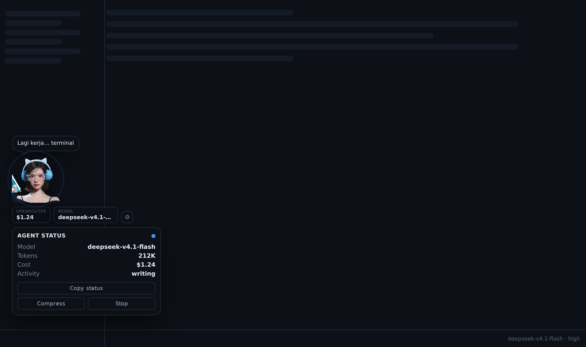
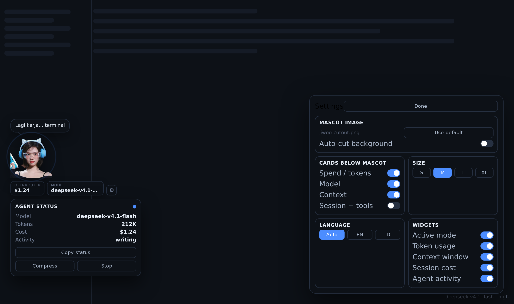

# Mascot Widget

A desktop plugin for [Hermes](https://hermes-agent.nousresearch.com): your agent gets a
mascot that sits in the corner of the window, says what it is doing, and keeps the
numbers you care about one glance away.

Single file. No build step, no dependencies, no network calls.




## What it does

- **Floating mascot** — drag it anywhere; the position is remembered per profile.
- **Speech bubble** — one short line that follows the agent: *idle*, *working… <tool>*,
  *done — your turn*, or a warning when the context window is nearly full.
- **Info cards** — up to four small readouts under the mascot: spend/tokens, model,
  context, session time + tool count. Each one is toggleable.
- **Agent Status bubble** — click the mascot: model, tokens, context used/max, session
  cost, activity, prompt-cache hit, plus a tool trail and **Copy status**.
- **Real actions** — *Compress* runs `session.compress`, *Stop* runs `session.interrupt`.
- **Settings** — the ⚙ button opens a two-column panel (mascot image, cards, size S/M/L/XL,
  language, widgets). On desktop builds with plugin settings pages, the same controls also
  appear under Settings ▸ Plugins ▸ Mascot Guide.
- **Bring your own mascot** — upload any PNG/WebP/JPG/SVG (≤700 KB). Optional
  auto-cut background for images shot on a plain backdrop.
- **Seven locales** (EN, ID, ES, PT, JA, ZH, KO, plus *auto* from the system locale), switchable per plugin.

## Install

```bash
mkdir -p "$HERMES_HOME/desktop-plugins/mascot-guide"
cp plugin.js "$HERMES_HOME/desktop-plugins/mascot-guide/plugin.js"
```

The plugin id (folder name) is **`mascot-guide`** — that is what the desktop app looks for,
even though the repository is called `mascot-widget`.

`$HERMES_HOME` is `~/.hermes` by default (`%LOCALAPPDATA%\hermes` on Windows), or
`~/.hermes/profiles/<name>` under a named profile. The folder name must match the plugin
id, `mascot-guide`.

Then restart the desktop app (or run **Reload desktop plugins** from the command palette if
your build has it). Remove by deleting the folder.

## Where the numbers come from

No polling, no scraping, no extra gateway traffic beyond one usage RPC:

| Readout | Source |
| --- | --- |
| model, profile, working dir, busy state | `host.state.*` atoms |
| tokens, context, cost, cache hit | `session.usage` RPC + live `session.usage` events |
| tool activity, agent turns | `tool.start`, `message.start`, `session.activate` events |

The plugin never reads credentials and never talks to a provider API. Account balance is
deliberately **out of scope**: reading it in the renderer would mean asking users to paste
an API key into a plugin, which is not something a public plugin should do.

## Compatibility notes

Hermes desktop builds differ in which plugin areas they render. This plugin is written
against the smallest useful surface so it loads widely:

- the floating mascot mounts from a `titleBar.right` slot (status-bar areas do not exist in
  older 0.22.x builds, so the compact readout does not depend on them);
- UI is hand-rolled with the plugin's own CSS — no `Tip`, `ToggleRow` or plugin-i18n imports
  that older builds do not export;
- a React error boundary keeps a visible stub instead of vanishing when a render throws.

## Development

```bash
./test/run.sh                                  # smoke test: real plugin file, stubbed SDK/react
python3 build_preview.py                       # regenerate preview.html (mascot + bubble)
python3 build_preview.py --with-settings       # ... with the settings panel open
```

`test/run.sh` copies `plugin.js` next to stub modules for `@hermes/plugin-sdk` and `react`,
calls `register(ctx)` with a mock context, and renders the float, the pane, the settings page
and the palette command — including the no-session path. It catches the failures that
otherwise show up only as a red toast in the app: an unresolvable import, a missing
component, or a hook used outside a component.

Rules worth remembering when editing `plugin.js`:

- plain ESM loaded uncompiled — `jsx('div', {...})`, never JSX syntax;
- only `@hermes/plugin-sdk`, `react` and `react/jsx-runtime` resolve;
- disk plugins are not scanned by Tailwind — ship CSS in a `<style>` tag and use theme
  variables (`var(--ui-text-secondary)`, `var(--ui-accent)`), never hardcoded colors;
- read atoms with `useValue(atom)` in components, `atom.get()` in handlers;
- never write plugin storage on pointer-move (drag) — keep a live atom and persist on release.

## Credits

The default mascot (`assets/mascot-default.svg`) is an original vector character drawn for this
plugin and ships under the same MIT license — no third-party artwork, nothing to attribute.
Replace it with your own image via **Mascot image**.
Built with Hermes desktop plugin SDK.

## License

MIT
